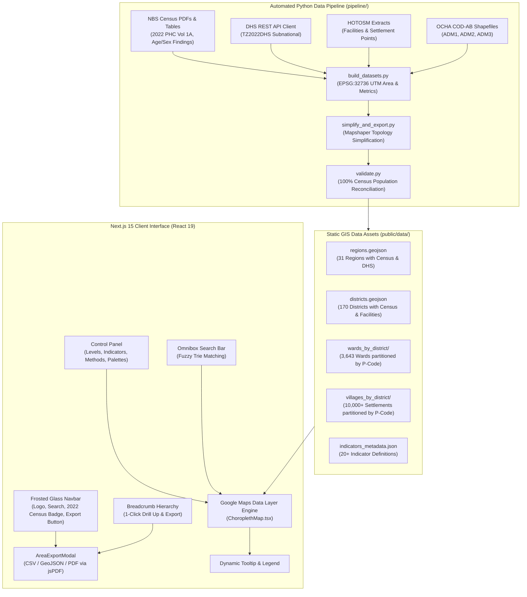

# Tanzania Demographic & Health Interactive Choropleth Map

[](https://nextjs.org/)
[](https://react.dev/)
[](https://www.typescriptlang.org/)
[](https://tailwindcss.com/)
[](https://creativecommons.org/licenses/by/4.0/)
[](https://opendatacommons.org/licenses/odbl/)

An interactive, multi-tiered subnational demographic and health visualization platform for the **United Republic of Tanzania**, built with **Next.js 15 (App Router)**, **React 19**, **TypeScript**, **Tailwind CSS**, and the **Google Maps JavaScript API Data Layer**.

The application provides choropleth mapping, exploratory spatial data analysis (ESDA), and individual area data export across all four administrative tiers of Tanzania: **31 Regions (ADM1)**, **170 Districts / Councils (ADM2)**, **3,643 Wards (ADM3)**, and **10,000+ Village Settlement Points**, harmonized against the **2022 National Population and Housing Census (PHC)**, the **2022 Tanzania Demographic and Health Survey (TDHS-MIS)**, and **Humanitarian OpenStreetMap Team (HOTOSM)** infrastructure registries.

---

## Table of Contents

- [Key Features](#key-features)
- [Administrative Hierarchy & Data Catalog](#administrative-hierarchy--data-catalog)
- [Individual Area Data Export System](#individual-area-data-export-system)
- [UI & Cartographic Design](#ui--cartographic-design)
- [System Architecture](#system-architecture)
- [Quickstart & Setup](#quickstart--setup)
- [Data Pipeline & Reproduction](#data-pipeline--reproduction)
- [Validation & Census Reconciliation](#validation--census-reconciliation)
- [Data Sources & Citations](#data-sources--citations)
- [Suggestions for Future Improvements & Roadmap](#suggestions-for-future-improvements--roadmap)
- [Project Structure](#project-structure)
- [License](#license)

---

## Key Features

* **Multi-Tier Administrative Hierarchy:**
  * **Regions (ADM1):** 31 regions nationwide (26 Mainland + 5 Zanzibar).
  * **Districts / Councils (ADM2):** 170 Local Government Authorities (LGAs), including city, municipal, town, and district councils.
  * **Wards (ADM3):** 3,643 wards nationwide, partitioned and lazy-loaded dynamically by district P-code for near-instant rendering.
  * **Villages / Settlements:** 10,000+ authenticated settlement point coordinates derived from OSM census records, loaded seamlessly on demand.
* **Analytical Integrity & Availability Indicator:**
  * Indicators not published at a particular administrative level are gracefully disabled with an explicit indicator badge (*"Not available at this level"*), eliminating fabricated estimations.
* **Scientific Cartography Controls:**
  * **Statistical Break Methods:** Natural Breaks (Fisher-Jenks / Ckmeans), Quantiles, and Equal Interval.
  * **Perceptually Uniform Palettes:** Color-blind safe scales (**Viridis**, **Cividis**, **Magma**, **Plasma**) and high-contrast sequential ramps (**Blues**, **Greens**, **YlOrRd**, **Purples**).
  * **Dynamic Transparency Slider:** Real-time opacity control (10% to 100%) for visual cross-referencing with satellite and road basemaps.
  * **Theme Toggle:** Dark and Light vector basemaps with contextual boundary styling.
* **Spatial Interactions & Navigation:**
  * **Fluid Drill-Down:** Click any region to zoom and partition into its districts; click any district to drill down into wards and genuine village points.
  * **Dynamic Hover Tooltip:** Displays unit name, parent administrative units, indicator values, formatting, and national/subnational rank.
  * **Breadcrumbs Navigation:** `Tanzania > Region > District > Ward` interactive breadcrumb path with direct jump-backs and quick-export action.
  * **Instant Omnibox Search:** Type-ahead search across all 3,800+ regions, districts, and wards with instant camera panning and zoom-to-extent.
* **Full-Featured Area Data Export:**
  * Dedicated individual area exports in **CSV**, **GeoJSON**, and formatted **A4 PDF Executive Summary Reports**.
  * Accessible from the top navigation bar, active breadcrumb badges, map feature clicks, and a floating selected-area quick card.

---

## Administrative Hierarchy & Data Catalog

The application cross-references over 20 demographic, socio-economic, and infrastructure indicators across administrative levels:

| Category | Indicator | Levels Available | Source | Unit & Format |
| :--- | :--- | :--- | :--- | :--- |
| **Demographics** | Total Population | Region, District, Ward | NBS 2022 Census | Persons (Integer) |
| | Land Area | Region, District, Ward | UTM EPSG:32736 | km² (Decimal) |
| | Population Density | Region, District, Ward | Computed | Persons / km² |
| | Sex Ratio (Males per 100 Females) | Region, District, Ward | NBS 2022 Census | Ratio (Decimal) |
| | % Population Under 15 | Region | NBS 2022 Census | % (1 Decimal) |
| | % Population 65+ | Region | NBS 2022 Census | % (1 Decimal) |
| | Average Household Size | Region, District, Ward | NBS 2022 Census | Persons / HH |
| | Number of Private Households | Region, District, Ward | NBS 2022 Census | Households (Integer) |
| **Growth & Settlement**| Intercensal Annual Growth (2012–2022) | Region, District, Ward | NBS 2012/2022 | % per annum |
| | Urban Share % | Region, District | NBS 2022 Census | % (1 Decimal) |
| | Rural Share % | Region, District | NBS 2022 Census | % (1 Decimal) |
| **Health & Wellbeing** | Total Fertility Rate (TFR) | Region | DHS 2022 | Children / Woman |
| | Child Stunting Rate (< -2 SD) | Region | DHS 2022 | % (1 Decimal) |
| | Under-5 Mortality Rate | Region | DHS 2022 | Deaths / 1,000 |
| | Facility-Based Deliveries | Region | DHS 2022 | % (1 Decimal) |
| | Health Facility Count | Region, District, Ward | HOTOSM 2024 | Facilities (Integer) |
| | Health Facility Density | Region, District, Ward | HOTOSM / NBS | Per 10,000 People |
| **Education & Infra** | Female Literacy Rate (15–49) | Region | DHS 2022 | % (1 Decimal) |
| | School Count | Region, District, Ward | HOTOSM 2024 | Schools (Integer) |
| | School Density | Region, District, Ward | HOTOSM / NBS | Per 1,000 Children (<15) |
| | Electricity Access | Region | DHS 2022 | % of Households |
| | Improved Water Source | Region | DHS 2022 | % of Households |
| | Improved Sanitation | Region | DHS 2022 | % of Households |
| | Agricultural Livelihood Share | Region | DHS 2022 | % of Households |

---

## Individual Area Data Export System

Rather than generic whole-view dumps, the application features an area-specific extraction engine powered by [`AreaExportModal.tsx`](file:///d:/TZ%20Demographic%20Map/src/components/AreaExportModal.tsx) and [`exportUtils.ts`](file:///d:/TZ%20Demographic%20Map/src/utils/exportUtils.ts).

### 1. Export Formats
* **CSV Export (`.csv`):**
  * Outputs an executive-formatted data sheet containing official NBS and DHS metadata headers, administrative hierarchy codes (P-codes), area dimensions, demographic summaries, health indicators, and infrastructure facility tallies.
* **GeoJSON Export (`.geojson`):**
  * Generates a standard GIS Feature object containing the exact simplified boundary geometry (or point coordinate for village settlements) and full attribute property payload, ready for direct analysis in **QGIS**, **ArcGIS**, **R**, or **Python (GeoPandas)**.
* **Executive PDF Report (`.pdf`):**
  * Generates a client-side A4 multi-page document rendered with `jspdf`.
  * Includes a styled top banner with the national badge, an administrative status indicator, a structured two-column demographic summary table, geographic coordinate markers, and official citations.

### 2. Export Trigger Access Points
1. **Top Navbar:** Click the solid emerald **"Export Area Data"** button to open the modal for the currently selected area or search any unit nationwide.
2. **Interactive Breadcrumbs:** Click the download icon embedded directly on the active breadcrumb tag.
3. **Map Drill-Down:** Clicking any polygon on the map automatically stages that feature as the active area for 1-click export.
4. **Floating Quick Card:** When an area is selected, a floating card in the bottom-left provides immediate 1-click access to download its dossier.

---

## UI & Cartographic Design

* **Typography:**
  * Clean, human-centered typography powered by Google's **Mulish** variable font across all interface panels, numeric statistics, tooltips, and map legends.
* **Glassmorphism Navigation Header:**
  * Top navigation bar built with frosted glass styling (`bg-slate-900/75 backdrop-blur-xl backdrop-saturate-150 border-white/[0.08]`), featuring subtle inner shadows and specular highlights.
* **High-Contrast Tactile Controls:**
  * Control panel buttons, dropdown triggers, and modal actions utilize solid dark finishes (`bg-slate-800` / `border-slate-700`) with clear hover and active states to guarantee high readability over complex map layers.
* **Pure Emerald Action Identity:**
  * Crucial context indicators—such as the **"2022 Census"** verification badge and the primary **"Export Area Data"** button—stand out in solid emerald (`bg-emerald-600 text-white`).
* **National Branding:**
  * Header features the national emblem and title badge, backed by high-resolution favicon and metadata configurations.

---

## System Architecture



---

## Quickstart & Setup

### Prerequisites
* **Node.js**: v18.0.0 or higher (v20+ LTS recommended)
* **npm**: v9.0.0+
* **Python**: v3.10+ (required only if regenerating datasets from raw source files)

### 1. Clone & Install Dependencies
```bash
git clone https://github.com/ibrahist/TZ-Demographic-Map.git
cd TZ-Demographic-Map
npm install
```

### 2. Configure Google Maps API Key
Create `.env.local` in the project root:
```bash
cp .env.example .env.local
```
Add your Google Maps JavaScript API key:
```env
NEXT_PUBLIC_GOOGLE_MAPS_API_KEY=AIzaSyYourActualGoogleMapsAPIKeyHere
```

> **Tip**: You can also run the application immediately and paste your API key in the browser using the in-app **API Key Configuration Modal** (accessible via the key icon in the top navbar).

### 3. Run Development Server
```bash
npm run dev
```
Open [http://localhost:3000](http://localhost:3000) in your browser.

### 4. Build for Production
```bash
npm run build
npm run start
```

---

## Data Pipeline & Reproduction

The entire data preparation pipeline is scripted and reproducible with a single command:

```bash
python -m pipeline.run
```

### Pipeline Modules:
1. [`pipeline/extract_census.py`](file:///d:/TZ%20Demographic%20Map/pipeline/extract_census.py): Parses official NBS 2022 Census Administrative Report tables, 2012 baseline tables, and age/sex findings.
2. [`pipeline/extract_dhs.py`](file:///d:/TZ%20Demographic%20Map/pipeline/extract_dhs.py): Fetches regional health, fertility, stunting, and living standard metrics from the official DHS Program REST API.
3. [`pipeline/extract_facilities.py`](file:///d:/TZ%20Demographic%20Map/pipeline/extract_facilities.py): Spatially aggregates 7,200+ health facilities and 100,000+ educational facilities by region, district, and ward.
4. [`pipeline/build_datasets.py`](file:///d:/TZ%20Demographic%20Map/pipeline/build_datasets.py):
   * Projects polygons to **UTM Zone 36S (`EPSG:32736`)** for accurate land area calculations in $\text{km}^2$.
   * Joins demographics to boundary shapefiles using official administrative P-codes.
   * Handles administrative changes (e.g. Songwe Region split from Mbeya in 2016, mapped via `data/unmatched.csv`).
5. [`pipeline/build_villages.py`](file:///d:/TZ%20Demographic%20Map/pipeline/build_villages.py): Extracts and validates genuine populated settlement points from OpenStreetMap records.
6. [`pipeline/simplify_and_export.py`](file:///d:/TZ%20Demographic%20Map/pipeline/simplify_and_export.py): Applies topology-preserving simplification via Mapshaper to produce optimized GeoJSON assets.
7. [`pipeline/validate.py`](file:///d:/TZ%20Demographic%20Map/pipeline/validate.py): Executes automated census target reconciliation checks.

---

## Validation & Census Reconciliation

Every dataset generated by the pipeline is reconciled against official National Bureau of Statistics (NBS) census benchmarks:

| Validation Test | Expected Official Value | Pipeline Generated Value | Variance / Status |
| :--- | :--- | :--- | :--- |
| **Regions (ADM1)** | 31 regions | 31 regions | **0 diff (100% Match)** |
| **Districts (ADM2)** | 170 councils | 170 councils | **0 diff (100% Match)** |
| **Wards (ADM3)** | 3,643 wards | 3,643 wards | **0 diff (100% Match)** |
| **National Population (Region Sum)** | 61,741,120 | 61,741,120 | **0.0000% error (Exact)** |
| **National Population (District Sum)** | 61,741,120 | 61,741,135 | **+15 (< 0.00003% rounding)** |
| **National Population (Ward Sum)** | 61,741,120 | 61,741,135 | **+15 (< 0.00003% rounding)** |

---

## Data Sources & Citations

Complete documentation of raw sources, licenses, and collection protocols is maintained in [`data/SOURCES.md`](file:///d:/TZ%20Demographic%20Map/data/SOURCES.md).

* **Administrative Boundaries (COD-AB):**
  * UN OCHA ROSA & National Bureau of Statistics (NBS) Tanzania.
  * License: [Creative Commons Attribution (CC BY 4.0 / CC BY-IGO)](https://creativecommons.org/licenses/by/4.0/).
* **2022 Population and Housing Census (PHC):**
  * National Bureau of Statistics (NBS) Tanzania & Office of the Chief Government Statistician (OCGS) Zanzibar.
  * Reports: *The 2022 Population and Housing Census: Administrative Report (Volume 1A)* and *Age and Sex Distribution Key Findings*.
  * License: Official Government Statistics (Public Domain / Open Data).
* **2012 Census Ward Baseline:**
  * NBS Tanzania & Humanitarian Data Exchange (HDX).
  * License: CC BY 4.0.
* **Tanzania Demographic and Health Survey (TDHS-MIS 2022):**
  * The DHS Program (USAID / ICF) & Ministry of Health Tanzania.
  * License: DHS Open Research Data.
* **Health, Education & Populated Places:**
  * Humanitarian OpenStreetMap Team (HOTOSM) & OpenStreetMap Contributors.
  * License: [Open Database License (ODbL 1.0)](https://opendatacommons.org/licenses/odbl/).

---

## Suggestions for Future Improvements & Roadmap

To expand the capabilities of this platform for researchers, policy analysts, humanitarian responders, and public health officials, the following engineering enhancements are suggested:

### 1. Cartography & Advanced Spatial Analytics
- [ ] **Bivariate Choropleth Mapping:** Allow users to visualize relationships between two variables simultaneously on a $3 \times 3$ color matrix (e.g., cross-referencing *Population Density* against *Health Facility Access* or *Child Dependency* against *School Density*).
- [ ] **3D Extrusion & Vector Prisms:** Integrate **Deck.gl** / **MapLibre GL** for 3D extruded prism heights proportional to population counts, providing rapid visual identification of urban centers (Dar es Salaam, Mwanza, Arusha, Mbeya, Dodoma).
- [ ] **Isochrone Catchment Analysis:** Compute travel-time contour polygons (walking vs. motorized transport) to the nearest primary health clinic or secondary school using OpenRouteService or Valhalla.
- [ ] **Spatial Autocorrelation (Local Moran's I):** Add automated cluster identification to highlight statistically significant hot spots ($High-High$), cold spots ($Low-Low$), and spatial outliers ($High-Low$).

### 2. Thematic Data Expansion
- [ ] **2022 Census Thematic Monographs Integration:** Incorporate forthcoming NBS monographs covering *Building Census & Housing Characteristics* (flooring, roofing, wall materials), *Economic Activity & Child Labor*, and *Disability Prevalence*.
- [ ] **Climate & Hazard Vulnerability Layers:** Integrate real-time satellite feeds from CHIRPS (precipitation anomaly), Copernicus drought severity indices, and flood vulnerability zones along major river basins (Rufiji, Ruvuma, Pangani).
- [ ] **High-Frequency Health Surveillance:** Incorporate national malaria incidence maps and routine DHIS2 immunization coverage metrics.

### 3. Comparative Analytics & Reporting
- [ ] **Side-by-Side Dual Map Comparison:** Split-screen map view enabling simultaneous comparison between two time periods (2012 vs. 2022) or two contrasting indicators.
- [ ] **Multi-Area Benchmark Matrix:** Compare up to 5 districts or wards side-by-side in an interactive spider radar chart or benchmarking table.
- [ ] **Batch Bulk Export:** Support one-click bulk export of all wards or villages within a chosen district as a packaged `.zip` containing GeoJSONs, CSVs, and PDF dossiers.
- [ ] **Native Excel (`.xlsx`) Export:** Add styled Microsoft Excel downloads with built-in formulas, sparklines, and auto-filters using `exceljs`.

### 4. Accessibility & Offline Support
- [ ] **Swahili (Kiswahili) Bilingual Localization:** Full internationalization (`next-intl`) toggle between Swahili and English across all UI labels, tooltips, and exported PDF reports.
- [ ] **Progressive Web App (PWA) & Offline Vector Tiles:** Cache PMTiles or MBTiles in IndexedDB via Service Workers to allow field officers to utilize maps without internet access in remote rural areas.
- [ ] **WCAG 2.1 AAA Accessibility:** Add high-contrast mode, accessible keyboard navigation for choropleth polygons, and screen-reader accessible tabular alternatives.

### 5. Natural Language & AI Insights
- [ ] **Conversational Demographic Assistant:** Integrate an embedded LLM assistant capable of answering natural language spatial queries (e.g., *"Which 5 districts in Dodoma region have the highest child stunting rate and the lowest health facility density?"*).
- [ ] **Automated Narrative Briefings:** Generate one-paragraph executive narrative summaries on the fly when inspecting any region, district, or ward.

---

## Project Structure

```text
TZ-Demographic-Map/
├── data/
│   ├── raw/                       # Cached raw archives (COD-AB, NBS PDFs, DHS JSON)
│   ├── processed/                 # Simplified GeoJSON boundaries & indicators metadata
│   ├── unmatched.csv              # P-code reconciliation audit log (Songwe split)
│   └── SOURCES.md                 # Detailed source documentation & licenses
├── pipeline/
│   ├── __init__.py
│   ├── config.py                  # Projection settings (EPSG:32736), paths, indicator catalog
│   ├── extract_census.py          # PDF table extractor for 2012/2022 NBS census publications
│   ├── extract_dhs.py             # REST API extractor for DHS subnational indicators
│   ├── extract_facilities.py      # Spatial point aggregator for health & education
│   ├── build_datasets.py          # Master dataset assembler & indicator computer
│   ├── build_villages.py          # Populated settlement extractor and district partitioner
│   ├── simplify_and_export.py     # Mapshaper topology-preserving simplification
│   ├── validate.py                # Automated census reconciliation test suite
│   └── run.py                     # Single-command orchestrator
├── public/
│   ├── data/                      # Processed GeoJSONs and JSON metadata served statically
│   └── tanzania.png               # National demographic emblem asset
├── scripts/
│   └── sync-data.mjs              # Data synchronizer from data/processed to public/data
├── src/
│   ├── app/
│   │   ├── globals.css            # Tailwind styling, custom scrollbars, and Mulish fonts
│   │   ├── icon.png               # Application favicon asset
│   │   ├── layout.tsx             # Root layout with Mulish font injection & metadata
│   │   └── page.tsx               # Main application view with state coordination
│   ├── components/
│   │   ├── ApiKeyModal.tsx        # In-browser Google Maps API configuration modal
│   │   ├── AreaExportModal.tsx    # Individual area data exporter (CSV, GeoJSON, PDF)
│   │   ├── Breadcrumbs.tsx        # Interactive trail with 1-click area export
│   │   ├── ChoroplethMap.tsx      # Google Maps JavaScript API Data layer implementation
│   │   ├── ControlPanel.tsx       # Solid-control sidebar for levels, indicators, palettes
│   │   ├── ExportButtons.tsx      # Navbar area export action trigger
│   │   ├── Legend.tsx             # Dynamic break ranges and palette swatch display
│   │   ├── SearchBar.tsx          # Frosted glass omnibox autocomplete search
│   │   └── Tooltip.tsx            # Floating feature inspection tooltip card
│   ├── types/
│   │   └── index.ts               # TypeScript interfaces for indicators, GeoJSON, and state
│   └── utils/
│       ├── colorScales.ts         # Statistical classification (ckmeans, quantiles) & ramps
│       ├── exportUtils.ts         # CSV, GeoJSON, and multi-page A4 PDF generators
│       └── formatters.ts          # Value and unit formatters
├── tailwind.config.ts             # Tailwind CSS tokens, colors, and Mulish font families
├── tsconfig.json                  # TypeScript compiler settings and path aliases
├── package.json                   # Project scripts and dependencies
└── README.md                      # Project documentation and roadmap
```

---

## License

* **Application Source Code:** Released under the [MIT License](https://opensource.org/licenses/MIT).
* **Boundaries & Census Data:** Contains public sector information governed by [CC BY 4.0](https://creativecommons.org/licenses/by/4.0/) (UN OCHA / NBS Tanzania).
* **OpenStreetMap Data:** Contains data licensed under the [Open Database License (ODbL 1.0)](https://opendatacommons.org/licenses/odbl/) by the OpenStreetMap Foundation and HOTOSM contributors.
